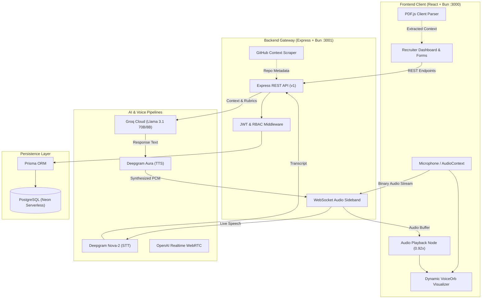

<div align="center">

# 🎙️ SignalForge

### **Real-Time Voice AI Technical Interviewer & Enterprise Hiring Platform**

[](https://bun.sh)
[](https://turbo.build)
[](https://www.typescriptlang.org/)
[](https://react.dev)
[](https://tailwindcss.com)
[](https://www.prisma.io)
[](https://neon.tech)
[](https://groq.com)
[](https://deepgram.com)
[](LICENSE)

<p align="center">
  <b>SignalForge</b> conducts full-duplex, natural voice technical interviews in real time, adapting questions dynamically to candidate resumes, target job descriptions, and GitHub activity — delivering instant structured evaluation scorecards, while providing engineering leaders with a multi-team recruitment dashboard.
</p>

[Explore Features](#-key-features) • [System Architecture](#-system-architecture) • [Multi-Team Hierarchy](#-enterprise-multi-team-hierarchy) • [Quickstart](#-quickstart) • [API Reference](#-api-reference)

---

</div>

## 🌟 Overview

Technical screening is traditionally slow, resource-heavy, and unstandardized. **SignalForge** bridges this gap by providing an end-to-end, conversational AI interviewer that feels like speaking directly with a staff engineer. 

Candidates experience a low-latency, voice-first interview environment with realistic conversational pacing, while talent teams leverage a hierarchical management dashboard to manage teams, post technical roles, bulk-schedule candidates, and review in-depth rubrics and scoring.

---

## ⚡ Key Features

### 🎙️ Dual-Engine Voice Architecture
* **Mode A (WebRTC Realtime)**: Ultra-low latency bidirectional audio streaming via the OpenAI Realtime API.
* **Mode B (Zero-Credit Fallback)**: High-fidelity voice pipeline combining:
  * **Deepgram Nova-2 STT**: Real-time websocket speech transcription with automatic punctuation and endpoint detection.
  * **Groq Llama 3.1 (70B / 8B)**: Lightning-fast conversational reasoning and dynamic follow-up generation.
  * **Deepgram Aura TTS**: Warm, natural human speech synthesis with browser-native pacing (`0.92x`) for maximum clarity.

### 🏢 2-Level Multi-Team & Organization Hierarchy
* **Flexible Org Structure**: Create multiple independent teams under parent organizations (e.g., *Frontend Core*, *Platform Infra*, *Data Engineering*).
* **Scoped Job Roles**: Post and manage technical roles mapped directly to specific teams.
* **Team Candidate Scoreboards**: Track candidate progress, status tags, and score percentiles isolated per team.
* **Bulk & Direct Scheduling**: Issue unique candidate interview tokens individually or bulk-schedule entire applicant cohorts with expiration safeguards.

### 📄 Contextual Candidate Ingestion
* **Client-Side PDF Resume Parsing**: Zero-upload PDF text extraction powered by **PDF.js** running in-browser — fast, private, and serverless.
* **Target Role & Job Description Alignment**: Tailor the conversation around custom job requirements, tech stacks, and seniority expectations.
* **GitHub Repository Scraper**: Enriches candidate profiles by automatically analyzing public repos, top languages, and contribution patterns.

### 📊 Automated Technical Evaluation & Rubrics
* **Interactive Scorecard**: Automatic generation of ratings across technical accuracy, problem-solving, architectural depth, and communication.
* **Categorized Feedback**: Actionable breakdown of candidate strengths, red flags, and tailored areas for professional growth.
* **Score Normalization**: 1-to-10 scoring benchmarked against industry role levels.

### 🎛️ Dynamic Audio Orb Visualizer
* **Reactive Canvas Animation**: Visual frequency ripples that expand and pulsate in sync with candidate microphone input and synthetic interviewer speech.
* **Conversational Pacing & Wrap-up Gates**: Configurable interview countdown timer (default 20 minutes) that signals the LLM to wind down conclusions before session termination.

### 🔒 Enterprise Security & RBAC
* **JWT Authentication**: Role-based access control guarding administrative endpoints.
* **Role Hierarchy**: Strict permission gates for `ADMIN`, `RECRUITER`, and `INTERVIEWER` accounts.

---

## 🏗️ System Architecture



---

## 🏢 Enterprise Multi-Team Hierarchy

SignalForge organizes engineering hiring into a clean two-level relational structure:

```text
Organization (e.g., "Acme Corp")
 ├── Team: Platform Infrastructure
 │    ├── Member: Lead Architect (Admin)
 │    ├── Job Role: Senior Distributed Systems Engineer
 │    │    └── Candidate: Interview Session #104 (Score: 8.5/10)
 │    └── Job Role: Kubernetes Specialist
 └── Team: Product Engineering
      ├── Member: Engineering Manager (Recruiter)
      ├── Job Role: Senior Fullstack Engineer
      └── Job Role: Mobile React Native Developer
```

---

## 🛠️ Tech Stack

| Domain | Technologies |
|---|---|
| **Runtime & Tooling** | [Bun](https://bun.sh) (v1.3+), [Turborepo](https://turbo.build) |
| **Frontend** | [React 19](https://react.dev), [TypeScript](https://www.typescriptlang.org/), [Tailwind CSS](https://tailwindcss.com), [Lucide React](https://lucide.dev), [Radix UI](https://www.radix-ui.com/) |
| **Backend** | [Express](https://expressjs.com), [Bun Server](https://bun.sh/docs/api/http), [WebSockets](https://github.com/websockets/ws), [Zod](https://zod.dev) |
| **Database & ORM** | [PostgreSQL (Neon Serverless)](https://neon.tech), [Prisma ORM](https://www.prisma.io/) |
| **AI Inference** | [Groq](https://groq.com) (Llama 3.1 70B / 8B Instant) |
| **Voice Processing** | [Deepgram Aura](https://deepgram.com) (TTS), [Deepgram Nova-2](https://deepgram.com) (STT), OpenAI Realtime |
| **Document Processing** | [PDF.js](https://mozilla.github.io/pdf.js/) (Client-side in-memory text parsing) |

---

## 📁 Repository Structure

```text
SignalForge/
├── apps/
│   ├── backend/                     # Express & Bun backend service
│   │   ├── prisma/                  # Prisma schema & migrations
│   │   ├── scrapers/                # GitHub profile & portfolio scraper
│   │   ├── auth.ts                  # JWT authentication & RBAC middleware
│   │   ├── db.ts                    # Prisma database client
│   │   ├── index.ts                 # Main REST & WebSocket server
│   │   ├── result.ts                # Groq evaluation & prompt pipeline
│   │   ├── sideband.ts              # Audio streaming & Deepgram orchestration
│   │   └── types.ts                 # Zod validation schemas & types
│   │
│   └── frontend/                    # React single-page client
│       ├── src/
│       │   ├── components/
│       │   │   ├── ui/              # Button, Card, Select, Input primitives
│       │   │   ├── Dashboard.tsx    # Multi-team recruiter dashboard
│       │   │   ├── Form.tsx         # Candidate intake & resume parser
│       │   │   ├── Interview.tsx    # Live voice interview room
│       │   │   ├── Result.tsx       # Performance scorecard & rubric display
│       │   │   └── VoiceOrb.tsx     # Dynamic audio visualizer canvas
│       │   ├── APITester.tsx        # Endpoint testing & diagnostic panel
│       │   ├── App.tsx              # Router & global context
│       │   └── index.css            # Custom styling & animations
│       └── build.ts                 # Bun client build pipeline
│
├── packages/
│   ├── eslint-config/               # Shared ESLint configurations
│   ├── typescript-config/           # Shared tsconfig presets
│   └── ui/                          # Shared UI design token package
│
├── turbo.json                       # Turborepo task pipeline
└── package.json                     # Monorepo root dependencies
```

---

## 🚀 Quickstart

### Prerequisites
* **Bun** installed globally:
  ```bash
  curl -fsSL https://bun.sh/install | bash
  ```
* A **PostgreSQL** database (e.g. free tier on [Neon](https://neon.tech))
* API Keys:
  * [Deepgram API Key](https://console.deepgram.com/) *(for Aura TTS and Nova-2 STT)*
  * [Groq API Key](https://console.groq.com/) *(for Llama 3.1 inference)*

### 1. Clone & Install
```bash
git clone https://github.com/rjmdhiraj/SignalForge.git
cd SignalForge
bun install
```

### 2. Configure Environment Variables
Create a `.env` file in `apps/backend/.env`:
```env
# Database
DATABASE_URL="postgresql://<user>:<password>@<neon-host>/<db>?sslmode=require"

# Speech Synthesis & Transcription (Deepgram)
DEEPGRAM_API_KEY="your_deepgram_api_key"

# LLM Reasoning & Evaluation (Groq)
GROQ_API_KEY="your_groq_api_key"
GROQ_MODEL="llama-3.1-8b-instant"

# Optional: WebRTC Realtime API Mode
OPENAI_KEY=""

# Security
JWT_SECRET="your-secure-jwt-secret"
PORT=3001
```

### 3. Initialize Database
Apply Prisma schema migrations to your database:
```bash
cd apps/backend
bunx prisma db push
bunx prisma generate
cd ../..
```

### 4. Run Development Servers
Start both backend and frontend concurrently with Turborepo:
```bash
bun run dev
```

* **Frontend**: [http://localhost:3000](http://localhost:3000)
* **Backend API**: [http://localhost:3001](http://localhost:3001)

---

## 📡 API Reference

### Organizations & Teams
| Method | Endpoint | Description | Auth |
|---|---|---|---|
| `POST` | `/api/v1/organization/create` | Create a new organization | Optional |
| `GET` | `/api/v1/organization/list` | List all organizations with nested teams, members, and jobs | Public |
| `DELETE` | `/api/v1/organization/:id` | Delete organization and cascade related records | Admin |
| `POST` | `/api/v1/organization/:orgId/teams` | Create a new team under an organization | Public |
| `GET` | `/api/v1/organization/:orgId/teams` | List all teams for a given organization | Public |
| `DELETE` | `/api/v1/organization/:orgId/teams/:teamId` | Delete a team and its scoped jobs | Admin |

### Team Jobs & Scheduling
| Method | Endpoint | Description | Auth |
|---|---|---|---|
| `GET` | `/api/v1/team/:teamId/jobs` | Retrieve technical job roles under a team | Public |
| `POST` | `/api/v1/team/:teamId/jobs` | Post a new job role scoped to a team | Recruiter |
| `DELETE` | `/api/v1/team/:teamId/jobs/:jobId` | Remove a job role | Recruiter |
| `GET` | `/api/v1/team/:teamId/candidates` | Get candidate scoreboard and results for team | Recruiter |
| `POST` | `/api/v1/team/:teamId/schedule-member` | Generate an interview token for an individual candidate | Recruiter |
| `POST` | `/api/v1/team/:teamId/schedule-all` | Bulk schedule interviews for all team candidates | Recruiter |

### Live Interview & Scoring
| Method | Endpoint | Description | Auth |
|---|---|---|---|
| `POST` | `/api/v1/pre-interview` | Validate candidate credentials, parse resume, start session | Public |
| `GET` | `/api/v1/interview/:id` | Fetch interview session state and questions | Public |
| `POST` | `/api/v1/session/local/respond/:id` | Submit candidate transcript response to LLM | Public |
| `GET` | `/api/v1/result/:interviewId` | Retrieve finalized candidate scorecard and evaluation | Public |
| `GET` | `/api/v1/config/status` | Health check and external API configuration status | Public |

---

## 📦 Production Build

To verify TypeScript types and create optimized production bundles:

```bash
# Build all workspaces
bun run build

# Output will be generated inside apps/frontend/dist/
```

---

## 🗺️ Roadmap

- [x] Full-duplex voice interaction with fallback audio sideband
- [x] Client-side PDF resume parsing (PDF.js)
- [x] Groq Llama 3.1 automated technical evaluation
- [x] 2-level enterprise Organization & Team hierarchy
- [x] Recruiter candidate pipeline scoreboard & bulk scheduling
- [ ] Code execution sandbox for live coding voice interviews
- [ ] ATS integrations (Greenhouse, Lever, Ashby)
- [ ] Multi-lingual interview support (Spanish, Mandarin, German)

---

## 🤝 Contributing

Contributions, issues, and feature requests are welcome!

1. Fork the Project
2. Create your Feature Branch (`git checkout -b feature/AmazingFeature`)
3. Commit your Changes (`git commit -m 'feat: add some AmazingFeature'`)
4. Push to the Branch (`git push origin feature/AmazingFeature`)
5. Open a Pull Request

---

## 📄 License

Distributed under the **MIT License**. See `LICENSE` for more information.

---

<div align="center">

Built with ❤️ by **[Rajat Malik](https://github.com/rjmdhiraj)**

*If you found this project helpful, give it a ⭐️ on [GitHub](https://github.com/rjmdhiraj/SignalForge)!*

</div>